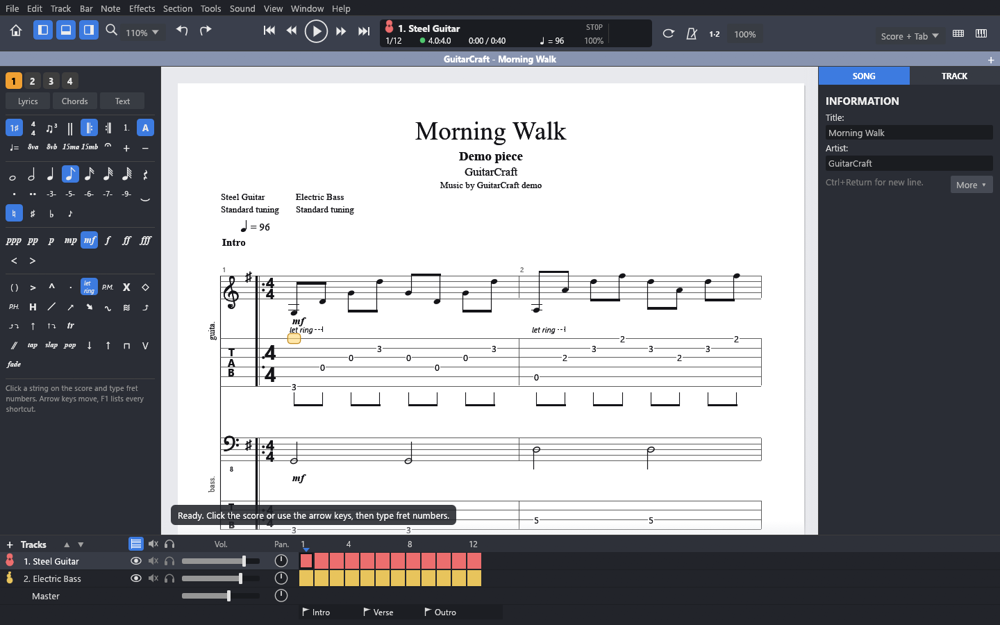
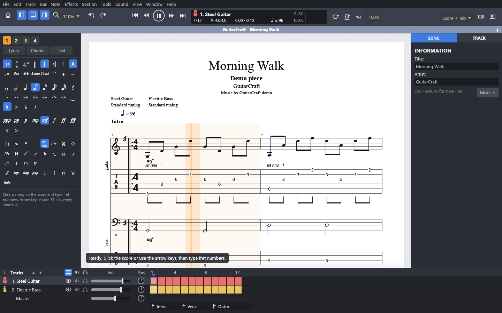
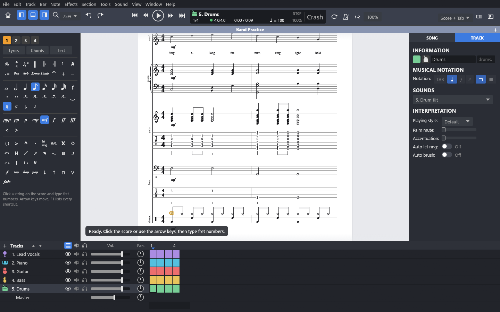
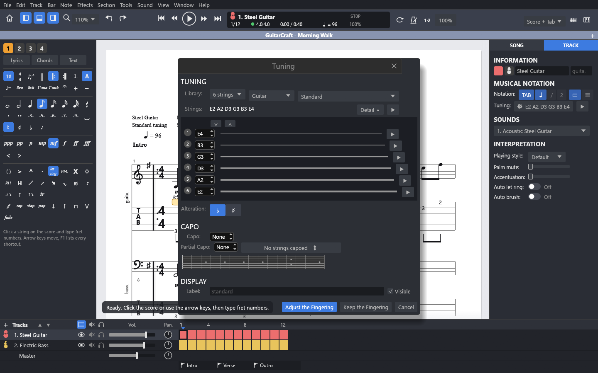

# GuitarCraft

<p align="center"></p>

**GuitarCraft** is a desktop app for writing, editing and playing guitar music, in tablature and standard notation, written in Rust.

It is a **clean-room clone of Guitar Pro 8**, generated with [Craft Anything](https://github.com/storytold/craft-anything). "Clean room" means the original program was never opened, run, decompiled or read: GuitarCraft was built from screenshots, the public user guide, and the community-documented file formats.

The goal is a good music editor, not an exact copy of Guitar Pro 8. GuitarCraft follows the original where that helps, but some of its features, such as the recorded sound banks, the pedalboard and audio tracks, may never be cloned.

GuitarCraft opens and saves Guitar Pro files (`.gp` and `.gp5`) and also opens `.gpx`, `.gp3`, `.gp4`, MIDI and plain-text tab, so you can keep working on the songs you already have. A song saved by GuitarCraft opens in Guitar Pro 8, with its tracks, notes, tuning, volume, pan, mute, solo and hidden tracks.

## Status

**Version 0.1.0, an early version for trying out (November 2026).** It is usable for writing and playing songs, but it is young: please save your work often, and keep a copy of any song you care about before editing it.

What works today:

- **Scores:** standard notation and tablature, together or apart; page and screen layouts; zoom; one track or many at once, with tracks you can hide; grand staff for keyboards and a percussion staff for drums.
- **Tracks:** guitars, basses, ukulele and banjo with any tuning and capo (including a partial capo); keyboards, vocals, orchestral instruments and drums, which never show tablature; an icon, colour, playing style and interpretation settings for each.
- **Editing:** entering notes on the tab or the staff, four voices per bar, selections, copy and paste, undo, transposing, and the editing palette: durations, dots, tuplets, rests, dynamics, crescendos, bends, slides, hammer-ons, let ring, palm mute, harmonics, vibrato, trills, grace notes, accents, strokes and more; repeats, alternate endings, Segno/Coda directions, sections, key and time signatures, tempo changes and lyrics. Bars with too many or too few beats turn red and say how much to add or remove.
- **Playback:** a built-in synthesizer for every instrument (no sound files needed), a mixer with volume, pan, mute and solo, looping a selection, a metronome and count-in, slower or faster practice speed with a speed trainer, and a cursor that follows each note as you hear it.
- **Tools:** a tuning window, chord and scale views, a fretboard and a keyboard view, an add-track window, a command palette, and MIDI, text tab and WAV export.

Not there yet: slash and numbered (jianpu) notation, printing and PDF export, and some of the less common symbols. Expect rough edges and differences from the original.

Not planned for now: the original's recorded sound banks and effects, the pedalboard, audio tracks and line-in. These are about sound production rather than writing music, so they may never be added.

<p align="center"></p>

<p align="center">


</p>

## Install

There are no ready-made downloads yet, so for now you build GuitarCraft yourself. It only takes a few minutes:

1. Install Rust from <https://rustup.rs> (accept the defaults). On Windows, the installer also offers the Microsoft C++ build tools it needs.
2. Download this repository (**Code → Download ZIP** on GitHub, then unzip it), or clone it with git.
3. Open a terminal in the folder and run:

   ```sh
   cargo run --release
   ```

   The first build downloads the libraries it uses and takes a few minutes; after that it starts straight away. The program itself ends up in `target/release/`.

To open a song directly: `cargo run --release -- "path/to/song.gp"`

## How to get involved

GuitarCraft is young, and the most useful help is:

1. **Try it** with your own songs and tell us what happens, especially files that open wrongly or differ from the original.
2. **Report bugs** in the Issues page, with the song file when you can share it.
3. **Improve it.** The code is all here; pull requests are welcome.

## About the author

I'm a .NET developer, and I'm using GuitarCraft as a way to learn Rust. The project was generated with [Craft Anything](https://github.com/storytold/craft-anything), and I'm working through the code to learn the language as it grows. Suggestions on writing more idiomatic Rust are as welcome as bug reports.

# Nerd Section

## Supported systems

| System | State |
| --- | --- |
| Windows 10 and 11 | Built and used every day |
| macOS and Linux | The libraries it uses run there, but it hasn't been built or tried yet |

## Building and testing

```sh
cargo build --release   # the program, in target/release/
cargo test              # the tests
```

The tests check, among other things, that songs survive a round trip through `.gp` and `.gp5` files, and that GuitarCraft writes the score-view part of a `.gp` file exactly as Guitar Pro 8 does (`samples/Empty.gp` is a song saved by Guitar Pro 8 for this).

A few command-line options help with checking and converting:

| Option | What it does |
| --- | --- |
| `--convert <from> <to>` | Opens a song (or `demo`) and saves it in the format of `<to>`, e.g. `.gp` or `.gp5` |
| `--screenshot <file.png>` | Draws the app, saves a picture and exits |
| `--gp-tests <folder>` | Writes the demo song as several `.gp` test files |

## How it is put together

- `src/model.rs`: songs, tracks, bars, voices, beats and notes, plus instrument types, clefs and tunings
- `src/score.rs`, `src/score/draw.rs`: laying out pages and lines and drawing notation, tablature and symbols
- `src/audio.rs`: the synthesizer (plucked strings, keys, voices, winds, drums) and playback through `cpal`
- `src/gpif.rs`, `src/gpifwrite.rs`, `src/gpsv.rs`: reading `.gp` and `.gpx` files and writing `.gp` files
- `src/gpimport.rs`, `src/gp5write.rs`: reading `.gp3`, `.gp4` and `.gp5` files and writing `.gp5` files
- `src/textmidi.rs`, `src/fileio.rs`: MIDI and text tab import and export, WAV export, opening and saving
- `src/app.rs`, `src/app/`: the window, menus, toolbar, palettes, inspector, tracks panel and dialogs, built with `egui`/`eframe`

## About the clean room

GuitarCraft has no connection with Arobas Music, the maker of Guitar Pro. Guitar Pro is their trademark, used here only to say which program GuitarCraft imitates and which files it opens. The program's code, icons and demo song were all made from scratch; no part of the original program, its files or its sounds is included or was looked inside.

## License

GuitarCraft is free software, released under the [GNU General Public License, version 3 or later](LICENSE). You may use, share and change it; if you share a changed version, it must be under the same license, with its source code.
