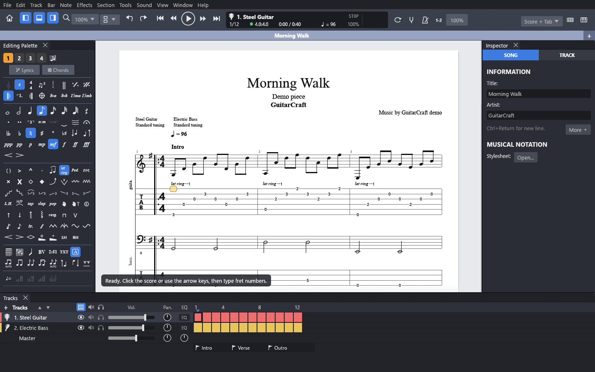
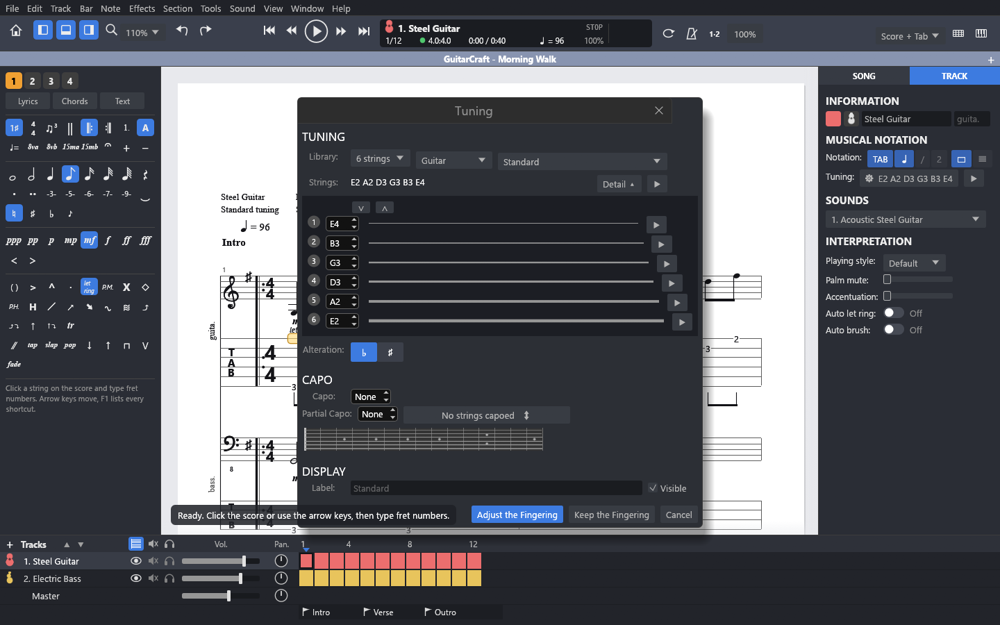
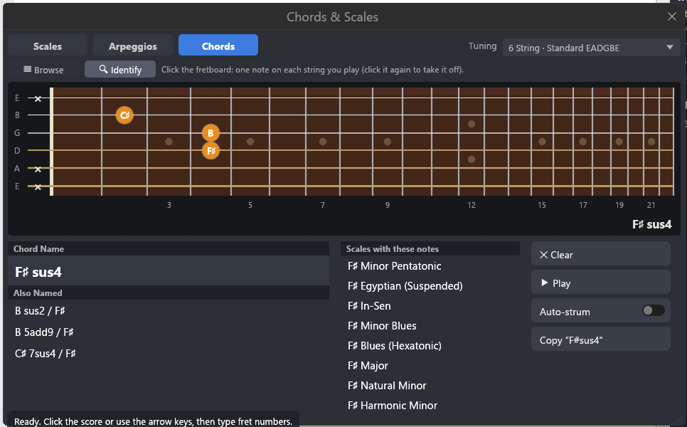
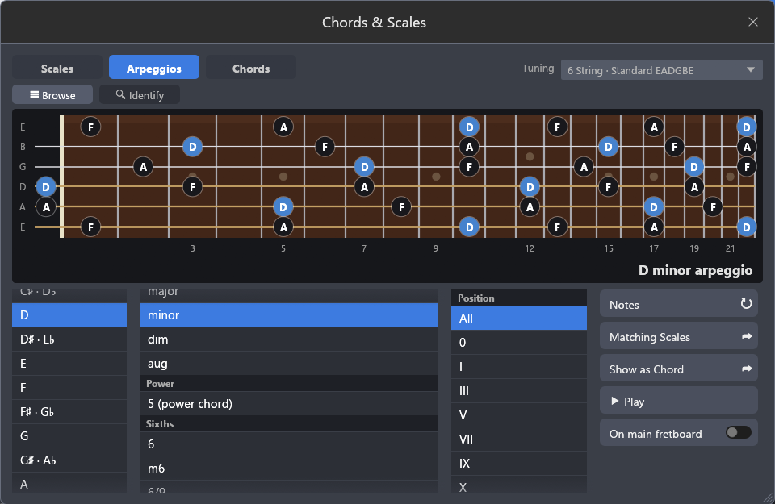
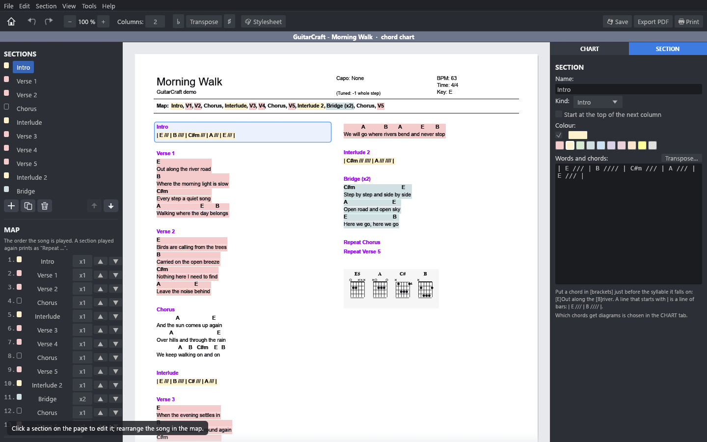
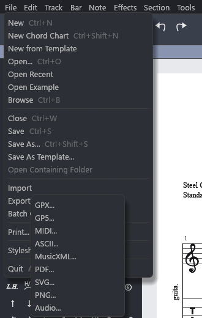
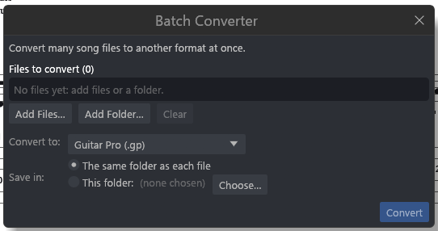

# GuitarCraft

<p align="center"></p>

**GuitarCraft** is a desktop app, written in Rust, for writing, editing and playing guitar music in tablature and standard notation, and for making chord charts: lyrics with the chords above them, ready to print.

It is a **clean-room clone of Guitar Pro 8**, generated with [Craft Anything](https://github.com/storytold/craft-anything). "Clean room" means the original program was never opened, run, decompiled or read: GuitarCraft was built from screenshots, the public user guide, and the community-documented file formats.

The goal is a good music editor, not an exact copy of Guitar Pro 8. GuitarCraft follows the original where that helps, but some of its features, such as the recorded sound banks, the pedalboard and audio tracks, may never be cloned.

GuitarCraft opens and saves Guitar Pro files (`.gp` and `.gp5`) and also opens `.gpx`, `.gp3`, `.gp4`, MusicXML, MIDI and plain-text tab, so you can keep working on the songs you already have. A song saved by GuitarCraft opens in Guitar Pro 8, with its tracks, notes, tuning, volume, pan, mute, solo and hidden tracks.

## Status

**An early version for trying out.** It is usable for writing and playing songs, but it is young: please save your work often, and keep a copy of any song you care about before editing it.

Not there yet: importing TablEdit and Power Tab files. Expect rough edges and differences from the original.

Not planned for now: the original's recorded sound banks and effects, the pedalboard, audio tracks and line-in. These are about sound production rather than writing music, so they may never be added.

<p align="center"></p>

<p align="center">


</p>

## Features

### Chords & Scales

**Tools > Chords & Scales** opens a pop-up toolkit for building and identifying chords, scales and arpeggios on a fretboard. Choose a root and a type from the lists and the notes light up on the neck, as note names or as intervals, over the whole neck or one position at a time. It has 47 scales and 48 chord types, in any of eight tunings or the tuning of the current track.

<p align="center">

</p>

- **Scales and arpeggios:** see every note of a scale, or the notes of a chord played one after another. "Matching Chords" lists the chords built on a scale, "Matching Scales" the scales that fit a chord, and "Scales in the bar" finds the scales that hold every note of the bars you have selected. Play them, or show them on the fretboard under the score.
- **Chords:** every chord type gets several playable fingerings, one for each part of the neck, drawn with finger numbers. The fingerings are worked out from the chord name and the tuning rather than looked up in a list, so unusual chords work too. "Put on beat" names the beat under the cursor and shows the chord diagram, and an empty beat gets the notes as well.
- **Identify:** click the notes you are playing on the fretboard and GuitarCraft names the chord, lists its other names (such as `B sus2 / F♯` for the same notes) and the scales that contain them.

<p align="center">


</p>

<p align="center"></p>

### Chord charts

**Chord charts** (File > New Chord Chart, Ctrl+Shift+N) are a second kind of document for lead sheets. You write sections of lyrics with chords inline (`[E]Let my heart be a [B]temple`) or as bars of chords (`| E /// | B //// |`), and a map sets the order the sections are played in. Moving a section moves it in the map, and the text flows through the columns and pages as in a word processor. The chord diagrams are worked out from the chord names and are optional.

<p align="center"></p>

Transpose (Ctrl+T, or the ♭ and ♯ buttons) moves the whole chart or a single section into another key, with sharps or flats. The tempo, key and time use the same editors as a score. Charts have their own stylesheet (F7), with Standard and Stage styles, and they print and export like scores. They are saved as `.gcx` files. There is a sample in `samples/`.

### Import, export and batch conversion

**File > Import** and **File > Export** are laid out like Guitar Pro 8's. Import takes MIDI, MusicXML (`.musicxml`, `.xml` and compressed `.mxl`) and ASCII tab. Export writes GPX (Guitar Pro 6), GP5, MIDI, ASCII tab, MusicXML, PDF, SVG, PNG and an audio recording (WAV). The GPX files are laid out as Guitar Pro 8 lays them out, and it opens them. (TablEdit and Power Tab are in the menu but greyed out, because their file formats aren't publicly described.) These menus work on scores; chord charts export to PDF and PNG.

<p align="center">


</p>

The **Batch Converter** (File > Batch Converter) turns many song files into another format in one go: add files or a whole folder, pick the format (Guitar Pro, GPX, GP5, MIDI, MusicXML, ASCII tab or PDF), and save them next to the originals or in one folder.

### More

- With the start screen (Browse) showing, only File (open and import) and Help are available, as in Guitar Pro 8.
- **Edition palette:** more note and beat marks (legato, wah, arpeggio, golpe, pick scrape, fingering, timer and more) and bar repeat signs. GuitarCraft writes and reads them the way Guitar Pro 8 stores them.
- **Chord library** for the chords used in a track, and reworked track icons and styles.
- **Printing:** File > Print (Ctrl+P), with a print preview.
- **Score context menu:** right-click the score for cut, copy and paste (also on all tracks at once), Special Paste, and the Bar, Note and Effects menus.
- **Special Paste** (Ctrl+Shift+V) pastes a selection several times over and lets you pick which extras come with it.
- **Playback follow:** during playback the view scrolls with the line of music being played.
- **Dockable panels:** the editing palette, inspector, tracks, fretboard, keyboard and AI Assistant can be dragged to any edge of the window, stacked as tabs, floated, or popped out into windows of their own (View > Pop Out Panel). The arrangement is remembered, and View > Reset Panel Layout puts it back.
- **Numbered (jianpu) notation:** the 2 button under Notation in the track settings adds a numbered lane under the track's other staves: scale degrees from the key's tonic, dots for octaves, underlines for short notes, dashes for long ones. It matches Guitar Pro 8's look; ties, tuplets and grace notes aren't drawn in it yet.
- **Command palette** (Ctrl+E) has three modes. Type `@` (or press Ctrl+Alt+E) for the **action list**: search and run any menu action, with its shortcut shown. Type `>` (or press Ctrl+Shift+E) for **expression text**: browse or type a chord, dynamic, key signature, octave sign or direction (such as `ff`, `G maj`, `8va`, `coda`) and put it on the score at the cursor, or any text above the beat.
- **AI Assistant** (View > Show AI Assistant, or `ai` in the command palette): ask Ollama or Claude a question about your music or about GuitarCraft, in a panel you can dock or float like the others. Nothing is sent until you press Return; you choose whether the bars at the cursor (or the selected ones) go along as ASCII tablature, and "What will be sent" shows exactly what leaves the program. It answers in words and never changes your score. Set up the provider in Preferences > AI.
- **Preferences** (File > Preferences, Ctrl+,): default template, forced zoom, page layout, stylesheet and notation, reopening last session's files, the playing cursor, notation error checks, your details for new songs, the audio device and buffer, AI provider settings (Ollama and Claude, with a connection test; the Claude API key is kept in the Windows Credential Manager, not in the preferences file; used by the AI Assistant panel), and keyboard shortcuts.
- **MIDI** (Preferences > Audio & MIDI): choose a MIDI output and playback goes to that device, with each track's instrument, volume, pan and bends, and clicked notes sound there too. The built-in sound is silent while an output is chosen unless you ask for both. Choose a MIDI input and the notes you play on a MIDI keyboard are entered at the cursor, notes played together as a chord. MIDI playback has been heard through the Windows GS Wavetable Synth; entering notes from a keyboard is written but hasn't been tried with a real keyboard yet. Real-time recording isn't there yet.
- **Mixer and tracks:** the mute and solo header buttons light up and clear every track at once, and hovering a bar number highlights that bar in every track.

## Install

On Windows, download the installer (`guitarcraft-<version>-windows-x64.msi`) from the [Releases page](https://github.com/CodeGator/GuitarCraft/releases) and run it. It installs just for you, with no administrator needed, unless you choose to install it for everyone. There is also a portable zip to run without installing. The installer isn't signed yet, so Windows may warn that the publisher is unknown: choose **More info → Run anyway**.

Or build GuitarCraft yourself. It only takes a few minutes:

1. Install Rust from <https://rustup.rs> (accept the defaults). On Windows, the installer also offers the Microsoft C++ build tools it needs.
2. Download this repository (**Code → Download ZIP** on GitHub, then unzip it), or clone it with git.
3. Open a terminal in the folder and run:

   ```sh
   cargo run --release
   ```

   The first build downloads the libraries it uses and takes a few minutes; after that it starts straight away. The program itself ends up in `target/release/`.

To open a song directly: `cargo run --release -- "path/to/song.gp"`

## Feedback

GuitarCraft is young, and the most useful help is:

1. **Try it** with your own songs and tell us what happens, especially files that open wrongly or differ from the original.
2. **Report bugs** in the Issues page, with the song file when you can share it.

GuitarCraft isn't taking code contributions or pull requests for now.

## About the author

I'm a .NET developer, and I'm using GuitarCraft as a way to learn Rust. The project was generated with [Craft Anything](https://github.com/storytold/craft-anything), and I'm working through the code to learn the language as it grows. Suggestions on writing more idiomatic Rust are as welcome as bug reports.

## Supported systems

| System | State |
| --- | --- |
| Windows 10 and 11 | Built and used every day |
| macOS and Linux | The libraries it uses run there, but it hasn't been built or tried yet |

## Building and testing

```sh
cargo build --release   # the program, in target/release/
cargo test --workspace  # the tests, including the xtask helper commands
```

The tests check, among other things, that songs survive a round trip through `.gp` and `.gp5` files, and that GuitarCraft reads and writes marks, track settings and other parts of a `.gp` file the way Guitar Pro 8 does (checked against files saved by Guitar Pro 8, in `tests/fixtures/`; its README lists each file and the test that reads it).

A few command-line options help with checking and converting:

| Option | What it does |
| --- | --- |
| `--convert <from> <to>` | Opens a song (or `demo`) and saves it in the format of `<to>`, e.g. `.gp` or `.gp5` |
| `--export <from> <to.pdf\|to.png> [dpi]` | Prints a song, chord chart, `demo` or `chart` (the sample chart) to a PDF or PNG |
| `--screenshot <file.png>` | Draws the app, saves a picture and exits |
| `--gp-tests <folder>` | Writes the demo song as several `.gp` test files |
| `--gpx-tests <folder>` | Writes `.gpx` test files, made from the demo song and from a `.gpx` saved by Guitar Pro 8 |

On Windows, GuitarCraft is a windowed app, so a terminal doesn't wait for it: its messages appear after the prompt returns. To wait for a run and get its exit code, use `Start-Process -Wait` in PowerShell or `start /wait` in cmd.

## Releasing

The version is kept in one place, `Cargo.toml`, and is changed with `cargo xtask version set X.Y.Z`. `packaging/windows/package.ps1` builds the Windows installer and a portable zip. See [docs/releasing.md](docs/releasing.md).

## About the clean room

GuitarCraft has no connection with Arobas Music, the maker of Guitar Pro. Guitar Pro is their trademark, used here only to say which program GuitarCraft imitates and which files it opens. The program's code, icons and demo song were all made from scratch; no part of the original program, its files or its sounds is included or was looked inside.

## License

GuitarCraft is free software, released under the [GNU General Public License, version 3 or later](LICENSE). You may use, share and change it; if you share a changed version, it must be under the same license, with its source code.
