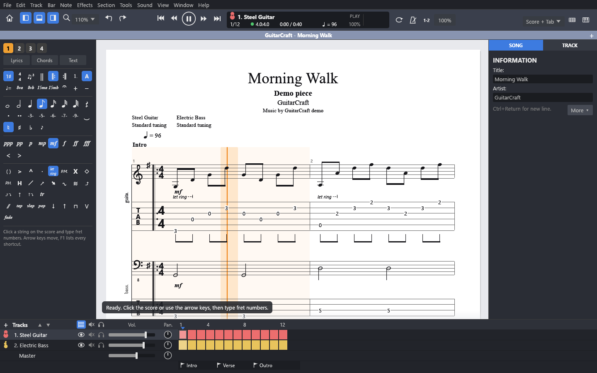
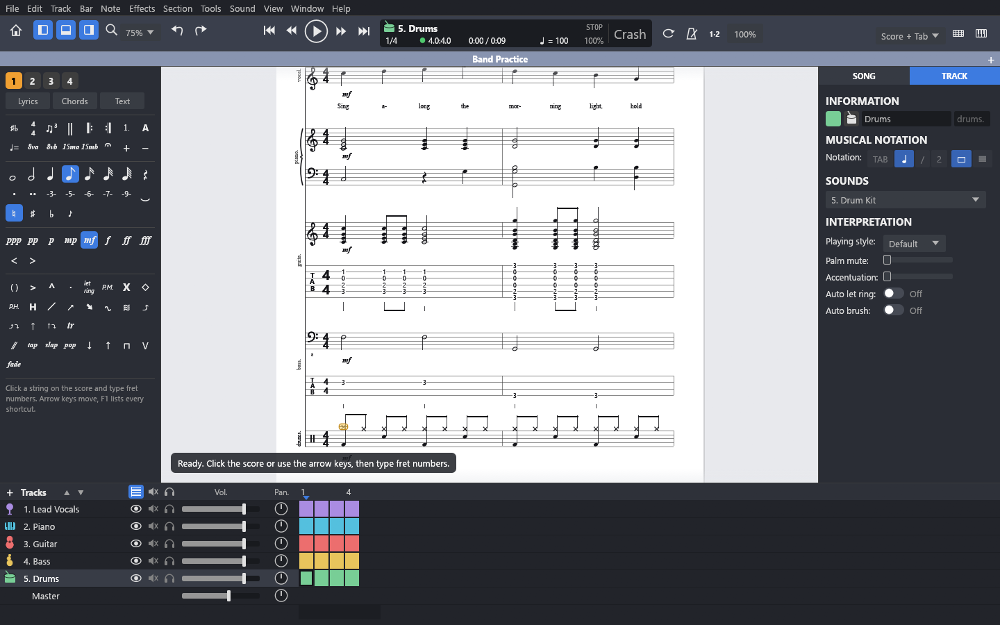

# GuitarCraft

<p align="center"></p>

**GuitarCraft** is a desktop app for writing, editing and playing guitar music, in tablature and standard notation, written in Rust.

It is a **clean-room clone of Guitar Pro 8**, generated with [Craft Anything](https://github.com/storytold/craft-anything). "Clean room" means the original program was never opened, run, decompiled or read: GuitarCraft was built from screenshots, the public user guide, and the community-documented file formats.

The goal is a good music editor, not an exact copy of Guitar Pro 8. GuitarCraft follows the original where that helps, but some of its features, such as the recorded sound banks, the pedalboard and audio tracks, may never be cloned.

GuitarCraft opens and saves Guitar Pro files (`.gp` and `.gp5`) and also opens `.gpx`, `.gp3`, `.gp4`, MIDI and plain-text tab, so you can keep working on the songs you already have. A song saved by GuitarCraft opens in Guitar Pro 8, with its tracks, notes, tuning, volume, pan, mute, solo and hidden tracks.

## Status

**Version 0.1.0, an early version for trying out (November 2026).** It is usable for writing and playing songs, but it is young: please save your work often, and keep a copy of any song you care about before editing it.

Not there yet: numbered (jianpu) notation, and MusicXML and SVG export. Expect rough edges and differences from the original.

Not planned for now: the original's recorded sound banks and effects, the pedalboard, audio tracks and line-in. These are about sound production rather than writing music, so they may never be added.

<p align="center"></p>

<p align="center">


</p>

## What's new

- **Chord charts** (File > New Chord Chart, Ctrl+Shift+N): a second kind of document for lead sheets. You write sections of lyrics with chords inline (`[E]Let my heart be a [B]temple`) or as bars of chords (`| E /// | B //// |`), and a map sets the order the sections are played in. The chord diagrams are worked out from the chord names. Transpose (Ctrl+T, or the ♭ and ♯ buttons) moves the whole chart or a single section into another key, with sharps or flats. Charts have their own stylesheet (F7), with Standard and Stage styles, and they print and export like scores. They are saved as `.gcx` files. There is a sample in `samples/`.
- **Edition palette:** more note and beat marks (legato, wah, arpeggio, golpe, pick scrape, fingering, timer and more) and bar repeat signs. GuitarCraft writes and reads them the way Guitar Pro 8 stores them.
- **Chord library** for the chords used in a track, and reworked track icons and styles.
- **Printing and export:** File > Print (Ctrl+P), and export to PDF or PNG.
- **Score context menu:** right-click the score for cut, copy and paste (also on all tracks at once), Special Paste, and the Bar, Note and Effects menus.
- **Special Paste** (Ctrl+Shift+V) pastes a selection several times over and lets you pick which extras come with it.
- **Playback follow:** during playback the view scrolls with the line of music being played.
- **Mixer and tracks:** the mute and solo header buttons light up and clear every track at once, and hovering a bar number highlights that bar in every track.

## Install

On Windows, download the installer (`guitarcraft-<version>-windows-x64.msi`) from the [Releases page](https://github.com/CodeGator/GuitarCraft/releases) and run it. It installs just for you, with no administrator needed, unless you choose to install it for everyone. There is also a portable zip to run without installing. The installer isn't signed yet, so Windows may warn that the publisher is unknown: choose **More info → Run anyway**.

Or build GuitarCraft yourself. It only takes a few minutes:

1. Install Rust from <https://rustup.rs> (accept the defaults). On Windows, the installer also offers the Microsoft C++ build tools it needs.
2. Download this repository (**Code → Download ZIP** on GitHub, then unzip it), or clone it with git.
3. Open a terminal in the folder and run:

   ```sh
   cargo run --release
   ```

   The first build downloads the libraries it uses and takes a few minutes; after that it starts straight away. The program itself ends up in `target/release/`.

To open a song directly: `cargo run --release -- "path/to/song.gp"`

## How to get involved

GuitarCraft is young, and the most useful help is:

1. **Try it** with your own songs and tell us what happens, especially files that open wrongly or differ from the original.
2. **Report bugs** in the Issues page, with the song file when you can share it.
3. **Improve it.** The code is all here; pull requests are welcome.

## About the author

I'm a .NET developer, and I'm using GuitarCraft as a way to learn Rust. The project was generated with [Craft Anything](https://github.com/storytold/craft-anything), and I'm working through the code to learn the language as it grows. Suggestions on writing more idiomatic Rust are as welcome as bug reports.

## Supported systems

| System | State |
| --- | --- |
| Windows 10 and 11 | Built and used every day |
| macOS and Linux | The libraries it uses run there, but it hasn't been built or tried yet |

## Building and testing

```sh
cargo build --release   # the program, in target/release/
cargo test --workspace  # the tests, including the xtask helper commands
```

The tests check, among other things, that songs survive a round trip through `.gp` and `.gp5` files, and that GuitarCraft writes the score-view part of a `.gp` file exactly as Guitar Pro 8 does (`samples/Empty.gp` is a song saved by Guitar Pro 8 for this).

A few command-line options help with checking and converting:

| Option | What it does |
| --- | --- |
| `--convert <from> <to>` | Opens a song (or `demo`) and saves it in the format of `<to>`, e.g. `.gp` or `.gp5` |
| `--export <from> <to.pdf\|to.png> [dpi]` | Prints a song, chord chart, `demo` or `chart` (the sample chart) to a PDF or PNG |
| `--screenshot <file.png>` | Draws the app, saves a picture and exits |
| `--gp-tests <folder>` | Writes the demo song as several `.gp` test files |

On Windows, GuitarCraft is a windowed app, so a terminal doesn't wait for it: its messages appear after the prompt returns. To wait for a run and get its exit code, use `Start-Process -Wait` in PowerShell or `start /wait` in cmd.

## Releasing

The version is kept in one place, `Cargo.toml`, and is changed with `cargo xtask version set X.Y.Z`. `packaging/windows/package.ps1` builds the Windows installer and a portable zip. See [docs/releasing.md](docs/releasing.md).

## About the clean room

GuitarCraft has no connection with Arobas Music, the maker of Guitar Pro. Guitar Pro is their trademark, used here only to say which program GuitarCraft imitates and which files it opens. The program's code, icons and demo song were all made from scratch; no part of the original program, its files or its sounds is included or was looked inside.

## License

GuitarCraft is free software, released under the [GNU General Public License, version 3 or later](LICENSE). You may use, share and change it; if you share a changed version, it must be under the same license, with its source code.
