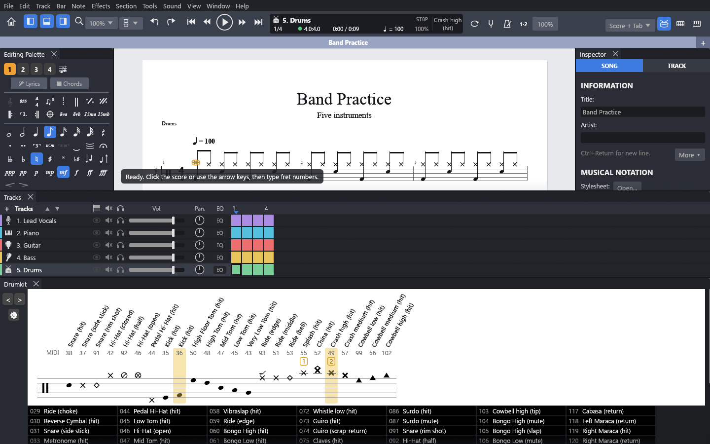
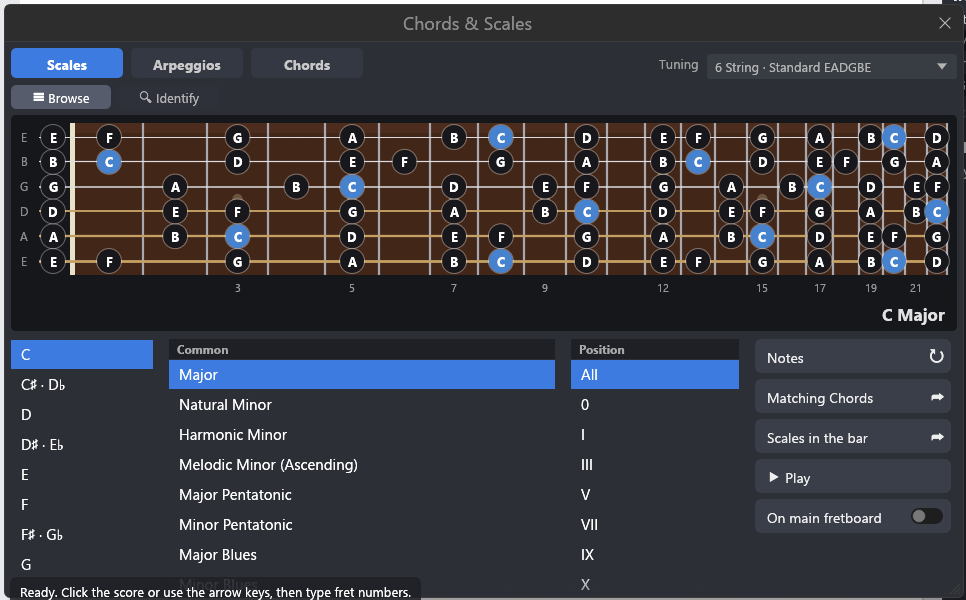
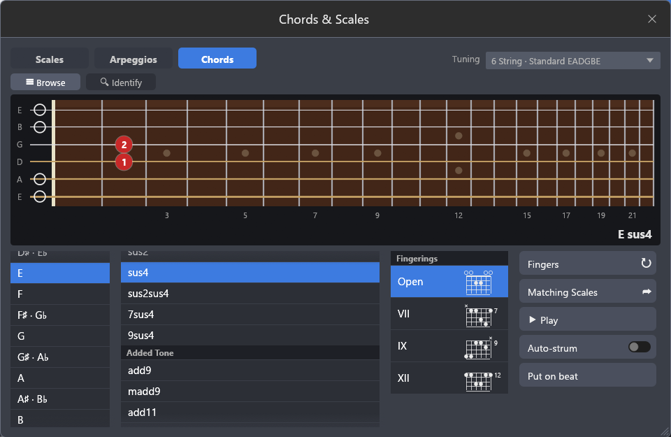

# GuitarCraft

GuitarCraft is a desktop app for Windows for writing, editing and playing guitar music in tablature and standard notation, and for making chord charts: lyrics with the chords above them, ready to print.

It is a clean-room clone of Guitar Pro 8, generated with [Craft Anything](https://github.com/storytold/craft-anything). The goal is a good music editor rather than an exact copy.

**It is an early version for trying out.** Save your work often, and keep a copy of any song you care about before editing it.

## Features

- **Write songs** for guitar, bass, drums, keyboard and other instruments, in tablature, standard or numbered notation, with fretboard, keyboard and drumkit views to click notes in.
- **Play them back** with the built-in sound or a MIDI device, with a mixer, looping and a speed trainer.
- **Fine-tune how notes sound:** how long they last, how early or late they start and how loud they are.
- **Keep your existing songs:** open Guitar Pro, MusicXML, MIDI and text tab files, and save songs that Guitar Pro 8 opens, keeping most of the settings its files already have.
- **Export and print** to Guitar Pro, MIDI, MusicXML, text tab, PDF, images and audio, and convert many files at once.
- **Find chords and scales** on the fretboard, or click some notes and see what chord they make.
- **Make chord charts** from lyrics and chords, transpose them and print them.
- **Arrange your workspace** with panels you can move, float or pop out into their own windows.
- **Ask an assistant** (optional) about your music or about GuitarCraft, or for chords to go with your lyrics.

The assistant uses Ollama or Claude, and nothing is sent until you ask. With Claude, your question and the related parts of your song or chart go to Anthropic; Claude Code also adds your account's email address, your operating system, the date and the top folder of your system drive.

Not there yet: importing TablEdit and Power Tab files. Not planned for now: Guitar Pro's recorded sound banks and effects, the pedalboard, audio tracks and line-in.

## Screenshots

**Writing a drum part with the drumkit view**

**A chord chart**

**Chords and scales: browse scales, arpeggios and chords, or name the notes you click**

## Install

Download the installer or the portable zip from the [Releases page](https://github.com/CodeGator/GuitarCraft/releases). The installer isn't signed yet, so Windows may warn that the publisher is unknown: choose **More info → Run anyway**.

## Feedback

The most useful help is to try GuitarCraft with your own songs and report what goes wrong on the Issues page, with the song file when you can share it. GuitarCraft isn't taking code contributions or pull requests for now.

## Development

GuitarCraft is written in Rust, and I'm a .NET developer using it as a way to learn the language, so suggestions are welcome. To build it, see the [development notes](docs/development.md).

## License

GuitarCraft is free software under the [GNU General Public License, version 3 or later](LICENSE).

"Clean room" means Guitar Pro was never opened, run, decompiled or read to build GuitarCraft: it was built from screenshots, the public user guide and community-documented file formats. GuitarCraft has no connection with Arobas Music; Guitar Pro is their trademark, used here only to say which program GuitarCraft imitates and which files it opens.
